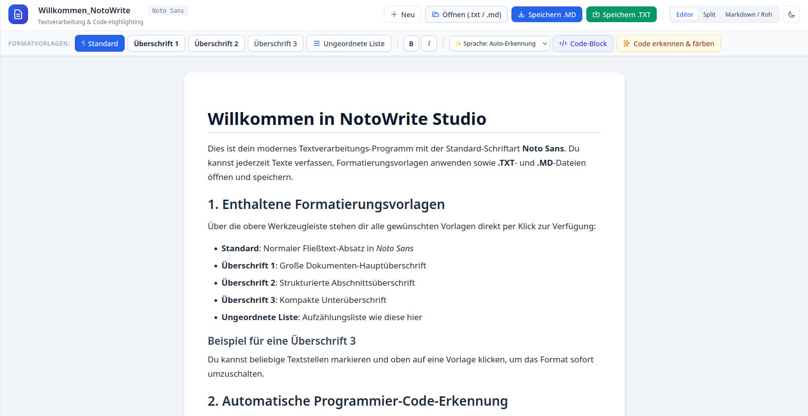
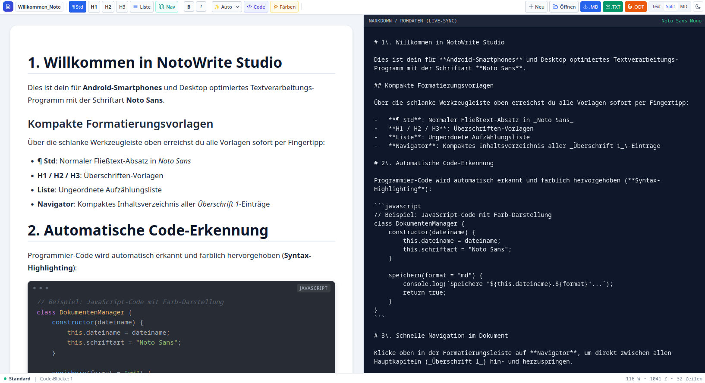

# NotoWrite Studio

&#x1F537; Webanwendung für Textverarbeitung und Markdown-Editing &#x1F537;

#editor #markdown #office

&#x27A1; **Einfaches und übersichtliches Textverarbeitungsprogramm**

*erstellt mit Gemini Argon*

**NotoWrite_Studio_*.html** herunterladen und mit dem Browser öffnen. 

*Erfolgreich getestet mit Linux Mint + Firefox 158.0.1 (64-Bit) und Samsung Smartphone Android 9*

## Umfang ##
- Text schreiben
- Verschiedene Formatvorlagen (Überschriften, Liste)
- Formatierung Fett, Kursiv
- Dateien öffnen und speichern (Dateiformate: txt und md)
- Ansicht für verschiedene Programmiersprachen
- Split-Ansicht (Markdown-Editor und Voransicht)
- reine Markdown-Ansicht

## Versionen ##

### Version 3.9 ###
- Im Rohdaten-Modus wurden im Split- und Vollansicht-Modus Zeilennummern eingefügt. Diese sind an den Text verankert.
- Im Rohdaten-Modus wird die aktuelle Zeile farblich markiert.

### Version 3.5 ###
- Kompatibilität der ODT-Dateien mit Libre Office (Fehler in styles.xml behoben)
- geordnete Liste mit Zahlen hinzugefügt

### Version 3.2 ###
- Unterstützung von OpenDocument-Dateien (ODT; OnlyOffice)

### Version 3.0 ###
- Ansicht kompakter
- Navigator eingefügt
- für Android optimiert

### Version 1.0 ###
- Basis-Variante

